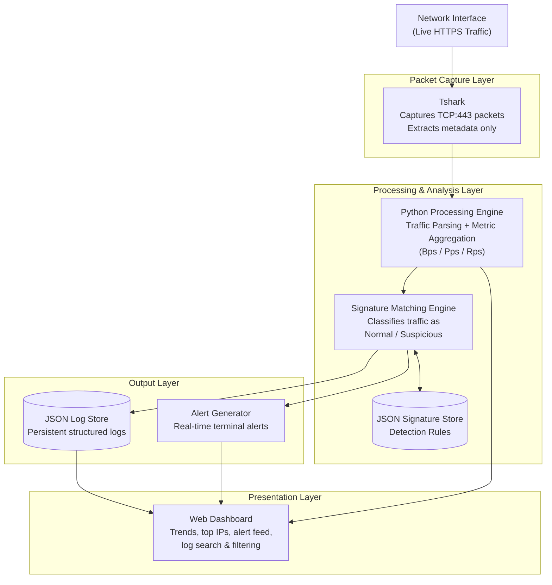

# Network-Security-Analyzer

A real-time, **rule-based DDoS detection and traffic monitoring tool** for HTTPS networks.

The system captures live network traffic, analyzes observable packet metadata against configurable detection rules, and raises immediate alerts when traffic matches a known DDoS attack pattern. It is designed to detect attacks within encrypted HTTPS traffic **without decrypting payloads**, relying entirely on metadata and traffic behavior.

> Graduation project, Middle East University, Faculty of Information Technology, Cybersecurity Department.

----

## Key Idea

HTTPS traffic is encrypted with TLS, so deep packet inspection cannot read the payload. This creates a visibility gap that application-layer (Layer 7) DDoS attacks exploit. Instead of decrypting traffic, this tool analyzes observable metadata that remains visible even under encryption: source and destination IP addresses, packet length, timestamps, TCP flags, and TLS handshake indicators.

Detection is **deterministic and explainable**: every alert maps directly to a specific rule that was triggered, rather than to a model prediction.

## Features

- **Live packet capture** from a local network interface using Tshark
- **Metadata-only analysis** of HTTPS traffic (no payload decryption)
- **Rule-based detection** across three DDoS categories:
  - Volume-based attacks (bits-per-second thresholds)
  - Protocol-level attacks such as SYN floods (packets-per-second analysis)
  - Application-layer attacks (requests-per-second tracking)
- **JSON-defined signatures** that can be edited or extended without changing the code
- **Real-time alerts** to the terminal, with structured **JSON logging** for historical investigation
- **Interactive web dashboard** (Python standard library, no framework) showing live Bps/Pps/Rps trends, top source IPs, and triggered alerts, with filtering and search

## Architecture Overview



See [docs/architecture.md](docs/architecture.md) for the full description.

## Technology Stack

| Component | Tool | Role |
|-----------|------|------|
| Packet capture | **Tshark** | Real-time sniffing of TCP:443 traffic with flexible filtering |
| Processing | **Python** | Core engine: parsing, metric aggregation, rule evaluation |
| Data storage | **JSON** | Human-readable signature rules and structured logs |
| Data processing | **Pandas + NumPy** | Traffic metrics and analysis |
| Dashboard | **Python `http.server` + HTML/JavaScript** | Live charts and alert visualization, no extra packages |
| Environment | **Local machine** | Controlled local deployment |

## Documentation

| Document | Contents |
|----------|----------|
| [docs/architecture.md](docs/architecture.md) | System architecture and component layers |
| [docs/data-formats.md](docs/data-formats.md) | JSON signature and log file schemas with examples |
| [docs/design.md](docs/design.md) | UML design diagrams (use case, class, sequence, activity, deployment, state) |
| [docs/implementation-notes.md](docs/implementation-notes.md) | Decisions made while building, and known limits |
| [docs/test-results.md](docs/test-results.md) | Lab scenarios, false-alarm check and throughput results |

## Setup

Requires Python 3.11+ and Wireshark (which includes Tshark and Npcap on Windows).

```bash
python -m venv .venv
.venv\Scripts\activate        # Windows (on Linux: source .venv/bin/activate)
pip install -r requirements.txt
```

## Running

Start monitoring (find the interface name with `--list-interfaces`, stop with Ctrl+C):

```bash
python -m analyzer --list-interfaces
python -m analyzer -i Wi-Fi
python -m analyzer -i Wi-Fi -d 60          # stop after 60 seconds
python -m analyzer -r capture.pcapng       # analyze a saved capture
```

Each run creates a session in `logs/`: `session_<date>_<number>.jsonl` (alerts) and `session_<date>_<number>_metrics.jsonl` (traffic rates per second). Edit the files in `signatures/` while it runs and the changes are loaded within 2 seconds. Run `python -m analyzer -h` for all options.

Open the dashboard in a second terminal (it reads `logs/` and refreshes every 2 seconds):

```bash
python -m analyzer.dashboard
```

Then open http://localhost:8501 in a browser. It only listens on this computer (127.0.0.1). The page shows live bandwidth, packet, request, SYN and handshake rates, the top source IPs, and the alert feed with severity, rule and text filters. Pick an earlier session from the sidebar to review it.

## Checking each part

Check the detection rules and run the tests:

```bash
python -m analyzer.signatures
python -m pytest -q
```

Watch the packets the analyzer sees (live, or from the included sample file):

```bash
python -m analyzer.capture --list-interfaces
python -m analyzer.capture -i Wi-Fi -c 20
python -m analyzer.capture -r tests/data/sample_https.pcapng
```

Watch live traffic rates, printed once per second (`-d 30` stops after 30 seconds):

```bash
python -m analyzer.metrics -i Wi-Fi -d 30
python -m analyzer.metrics -r tests/data/sample_https.pcapng
```

Live capture may need an administrator terminal, depending on how Npcap was installed.

## Test lab

`tools/` holds a small lab that attacks only this computer: a local HTTPS server on 127.0.0.1:8443 (`lab_server.py`, self-signed certificate made on first run), traffic generators (`traffic.py`) and a runner (`run_lab.py`) that starts a fresh analyzer session per scenario and checks which rules fired:

```bash
python tools/run_lab.py            # Windows loopback adapter
python tools/run_lab.py -i lo      # Linux loopback
python tools/bench.py              # packets per second the detection code can handle
```

Scenarios: normal browsing, TLS handshake flood, HTTPS request flood, TCP connection (SYN) flood, a connection flood spread over 100 loopback addresses, and an upload (bandwidth) flood. Results are in [docs/test-results.md](docs/test-results.md).

## Project Status

Implementation and testing done.

Numbers match the report sections.

| Section | Part | Status |
|---------|------|--------|
| 6.1 | Signature store and loader (`signatures/`, `analyzer/signatures.py`) | Done |
| 6.2 | Packet capture and parsing (`analyzer/capture.py`) | Done |
| 6.3 | Traffic metrics (`analyzer/metrics.py`) | Done |
| 6.4 | Detection engine, alerts and JSON logs (`analyzer/detection.py`, `analyzer/alerts.py`) | Done |
| 6.5 | Monitoring session and main program (`analyzer/session.py`, `python -m analyzer`) | Done |
| 6.6 | Web dashboard (`analyzer/dashboard.py`, `analyzer/static/index.html`, `analyzer/dashboard_data.py`) | Done |
| 7 | Test lab and results (`tools/`, [docs/test-results.md](docs/test-results.md)) | Done |

## Team

Hamzeh Amireh · Basil Awadallah · Khalid Daghlass · Malik Alqudah
Supervised by Dr. Basem Al-Absi.
