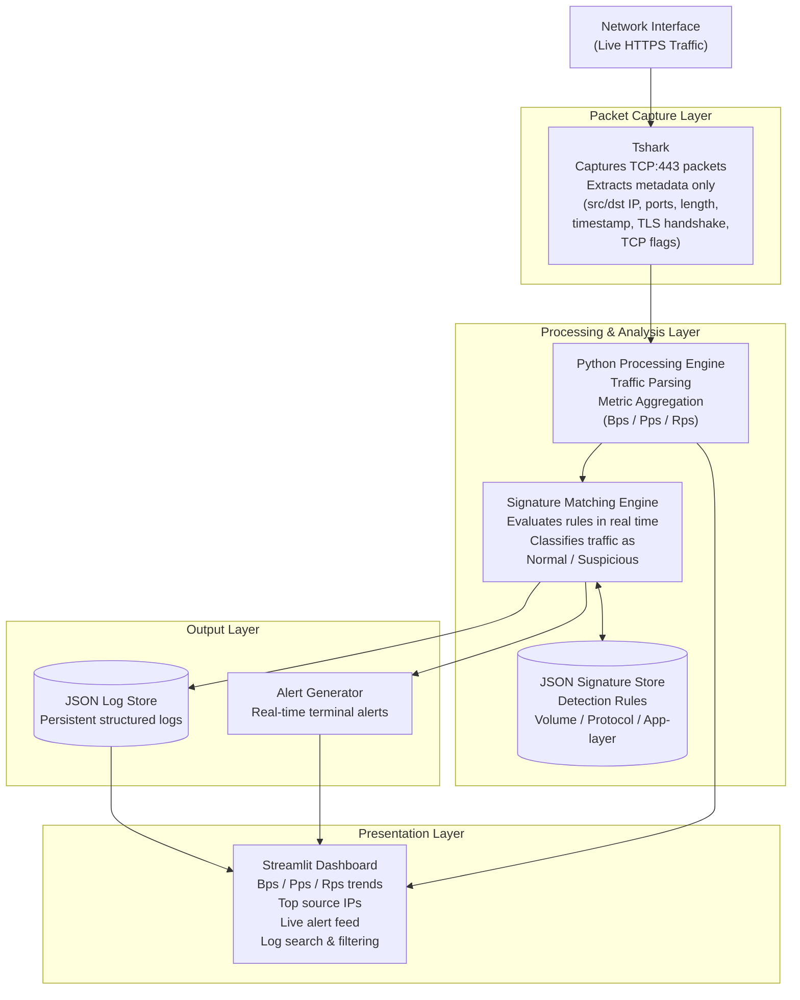

# System Architecture

The system uses a layered, pipeline-based architecture composed of five layers. Data flows linearly from raw network traffic through to visualized alerts and logs.

## Layers

### Traffic Input Layer
The entry point is the host machine's network interface, which receives all network packets. The system monitors live traffic in real time without changes to the network topology or additional hardware.

### Packet Capture Layer (Tshark)
Built on Tshark, the command-line interface of Wireshark. Tshark attaches to the selected interface and captures packets in real time, filtered to HTTPS traffic on TCP port 443. For each packet it extracts observable network-level and TLS-level metadata: source and destination IP, source and destination ports, packet length, timestamp, TLS handshake indicators, protocol, and TCP flags. Because payloads are encrypted, no payload content is inspected. Extracted fields are streamed to the Python engine.

### Processing and Analysis Layer (Python Engine)
The core engine receives the metadata stream and performs three operations:

1. **Traffic Parsing** — records are parsed and normalized into a consistent internal format.
2. **Signature Matching** — parsed metadata is evaluated against detection rules loaded from JSON. Each signature defines a DDoS pattern through threshold conditions (request rate, TLS handshake frequency, packet burst size, repeated connection attempts). Matching traffic is classified as suspicious.
3. **Metric Aggregation** — the engine continuously computes Bps, Pps, and Rps, consumed by both the alert generator and the dashboard.

The engine runs uninterrupted, maintaining internal state for time-windowed calculations.

### Signature Store (JSON Files)
Detection rules are stored externally as JSON, decoupled from the engine's source. Rules can be added, modified, or removed without code changes. The engine loads them at startup and re-evaluates them continuously against live traffic. See [data-formats.md](data-formats.md).

### Output Layer (Alerts and Logs)
On a match, two outputs are produced in parallel:

- **Real-time Alert** — timestamp, source IP, triggered signature, attack category, severity, and traffic statistics, displayed immediately on the terminal.
- **Structured JSON Log** — all alert events plus corresponding metadata, written to a persistent log file for audit and historical investigation.

### Presentation Layer (Streamlit Dashboard)
The dashboard reads from the live metric aggregator and the JSON log store. It displays time-series charts for Bps/Pps/Rps, a ranked list of top source IPs, a live alert feed with filtering, and historical log search. It is served locally and accessed via a browser.
