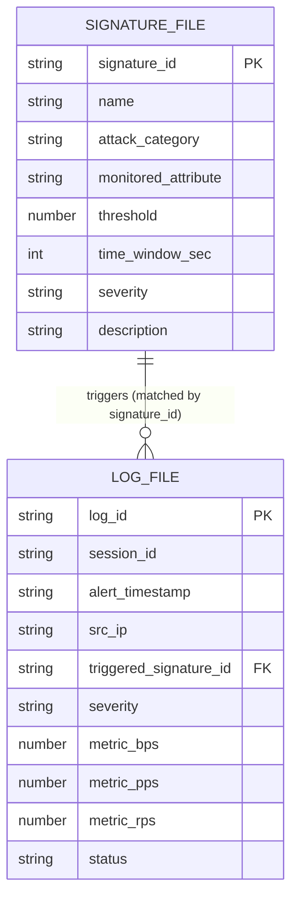

# Data Formats

The system persists data in **structured JSON files** rather than a relational database. JSON was chosen because it is natively supported by Python, human-readable, and well-suited to semi-structured event records where fields may vary between packet and alert types. It also keeps the deployment lightweight with no database dependency.

There are two categories of data file: **signature files** and **log files**.

---

## Signature Files

Signature files store the detection rules the analysis engine evaluates against live traffic. They are read-only at runtime and modified only by an analyst. Each file represents one attack category and contains an array of rule objects.

| Field | Type | Required | Description |
|-------|------|----------|-------------|
| `signature_id` | string | Yes | Unique identifier (e.g., `"VOL-001"`) |
| `name` | string | Yes | Human-readable name of the signature |
| `attack_category` | string | Yes | One of: `volume`, `protocol`, `application` |
| `monitored_attribute` | string | Yes | One of: `bps`, `pps`, `rps`, `syn_rate`, `tls_handshake_rate` |
| `threshold` | number | Yes | Per-second rate that triggers detection when exceeded (must be above 0) |
| `time_window_sec` | integer | Yes | Rolling time window in seconds; the rate is averaged over this window |
| `severity` | string | Yes | One of: `low`, `medium`, `high`, `critical` |
| `scope` | string | No | `per_source` (default): each source IP is measured on its own. `global`: all traffic is measured together, which catches distributed attacks spread over many IPs |
| `description` | string | No | Plain-language explanation of the pattern |

A rule fires when the monitored attribute, averaged over the last `time_window_sec` seconds, goes above `threshold`. Signature IDs must be unique across all files.

### Example

```json
{
  "signature_id": "APP-002",
  "name": "HTTPS Request Rate Flood",
  "attack_category": "application",
  "monitored_attribute": "rps",
  "threshold": 200,
  "time_window_sec": 5,
  "severity": "high",
  "scope": "per_source",
  "description": "One source IP sends more than 200 HTTPS requests per second, averaged over 5 seconds, indicating an HTTP flood."
}
```

---

## Log Files

Log files are written during live operation. Each generated alert appends an entry to the active session's log file. Log files are append-only at runtime and are queried by the dashboard for historical review.

Log files use **JSON Lines**: one complete JSON object per line. Appending a line never rewrites earlier entries, and if the program stops mid-write only the last line is affected (the reader skips it).

| Field | Type | Required | Description |
|-------|------|----------|-------------|
| `log_id` | string | Yes | Unique identifier for the entry (UUID) |
| `session_id` | string | Yes | Identifier of the monitoring session |
| `alert_timestamp` | string | Yes | ISO 8601 timestamp of when the alert was generated |
| `src_ip` | string | Yes | Source IP of the suspicious traffic (for a `global` rule, the busiest source at that moment) |
| `dst_ip` | string | Yes | Destination IP |
| `src_port` | integer | Yes | Source port |
| `dst_port` | integer | Yes | Destination port (typically 443) |
| `packet_length` | integer | Yes | Packet length in bytes |
| `protocol` | string | Yes | Protocol (e.g., `TCP`, `TLS`) |
| `tcp_flags` | string | Yes | TCP flag string (e.g., `SYN`, `ACK`) |
| `tls_handshake` | boolean | Yes | Whether a TLS handshake was detected |
| `sni` | string | No | Server Name Indication from the TLS handshake |
| `triggered_signature_id` | string | Yes | `signature_id` of the matched rule |
| `triggered_signature_name` | string | Yes | Human-readable name of the matched signature |
| `attack_category` | string | Yes | Category of the matched signature (`volume`, `protocol`, `application`) |
| `severity` | string | Yes | Severity inherited from the matched signature |
| `scope` | string | Yes | Scope of the matched signature (`per_source` or `global`) |
| `monitored_attribute` | string | Yes | Attribute the signature measured |
| `observed_value` | number | Yes | Measured per-second rate that broke the rule |
| `threshold` | number | Yes | The signature's threshold, so the log explains itself |
| `metric_bps` | number | Yes | Bits per second at the time of the alert (for the source, or overall for a `global` rule) |
| `metric_pps` | number | Yes | Packets per second at the time of the alert (same basis) |
| `metric_rps` | number | Yes | Estimated requests per second at the time of the alert (same basis) |
| `status` | string | Yes | One of: `new`, `reviewed`, `dismissed` |

### Example

```json
{
  "log_id": "a3f2c1d4-8b0e-4f5a-9c2d-1e7b6f3a0d88",
  "session_id": "session-2026-05-23-001",
  "alert_timestamp": "2026-05-23T14:32:07.441Z",
  "src_ip": "192.168.1.45",
  "dst_ip": "192.168.1.100",
  "src_port": 52341,
  "dst_port": 443,
  "packet_length": 1420,
  "protocol": "TLS",
  "tcp_flags": "ACK",
  "tls_handshake": false,
  "sni": "targetsite.local",
  "triggered_signature_id": "APP-002",
  "triggered_signature_name": "HTTPS Request Rate Flood",
  "attack_category": "application",
  "severity": "high",
  "scope": "per_source",
  "monitored_attribute": "rps",
  "observed_value": 214,
  "threshold": 200,
  "metric_bps": 18540000,
  "metric_pps": 1620,
  "metric_rps": 214,
  "status": "new"
}
```

---

## Metrics Files

The dashboard runs as a separate process and cannot read the engine's memory, so each session also writes its traffic rates to a metrics file: one JSON line per second of traffic, appended when the next second begins. Seconds with no traffic on the protected port write no line; the dashboard shows a gap as zero. That is an instant view: the detection engine itself always uses the full rolling average.

| Field | Type | Description |
|-------|------|-------------|
| `time` | integer | The whole second the line covers (seconds since 1970, UTC); rates are as of the end of that second |
| `bps`, `pps`, `rps` | number | Overall bits, packets and estimated requests per second, averaged over the metrics window |
| `syn_rate`, `tls_handshake_rate` | number | Overall SYN packets and TLS handshakes per second |
| `top_sources` | array | Up to 5 `[source_ip, packets_per_second]` pairs, busiest first |

### Example

```json
{"time": 1794763801, "bps": 1181030.4, "pps": 1425.6, "rps": 118.8, "syn_rate": 119.0, "tls_handshake_rate": 119.0, "top_sources": [["127.0.0.1", 1425.6]]}
```

---

## Relationship



## File Naming and Storage

| File Type | Naming Convention | Location | Access Mode |
|-----------|-------------------|----------|-------------|
| Signature file | `<category>_signatures.json` (e.g., `volume_signatures.json`) | `/signatures/` | Read-only at runtime |
| Log file | `session_<date>_<id>.jsonl` (e.g., `session_2026-05-23_001.jsonl`) | `/logs/` | Append-only at runtime |
| Metrics file | `session_<date>_<id>_metrics.jsonl` | `/logs/` | Append-only at runtime |

Session IDs follow the same pattern (`session-2026-05-23-001`). The number counts up from the highest existing session of that day, so restarting never overwrites an earlier session.
