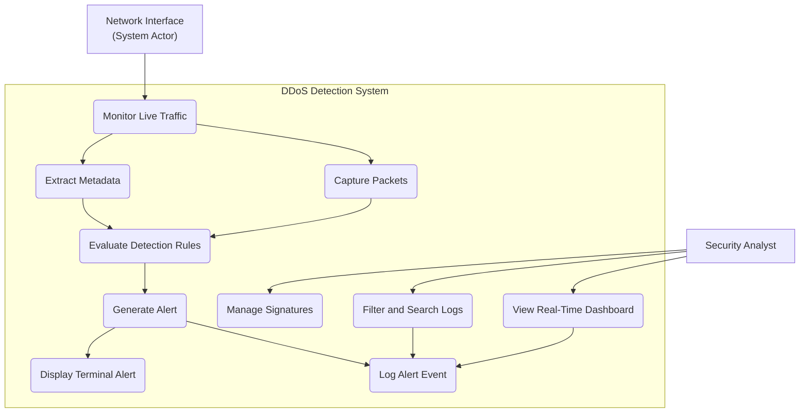
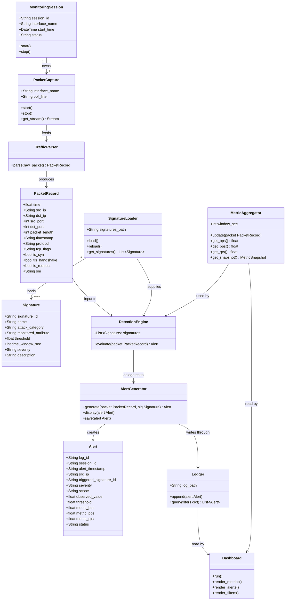
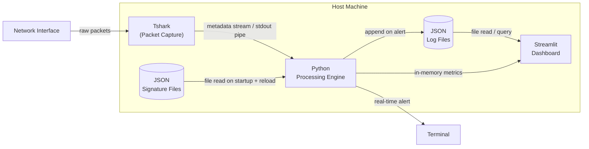
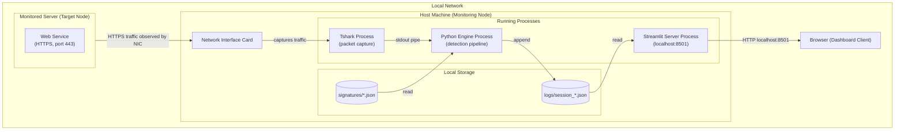
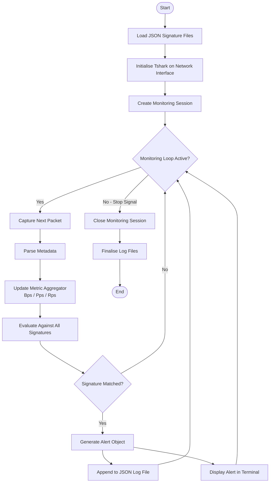
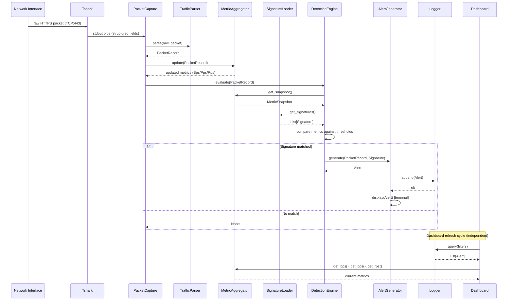
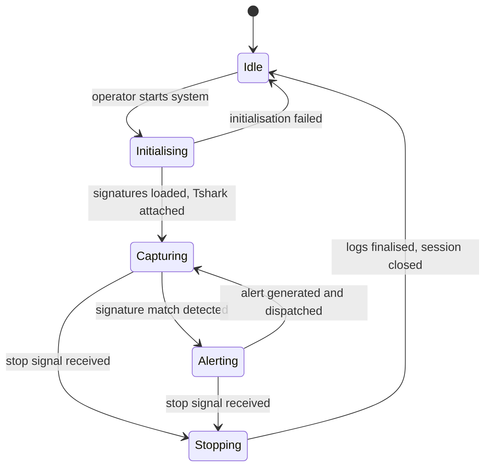
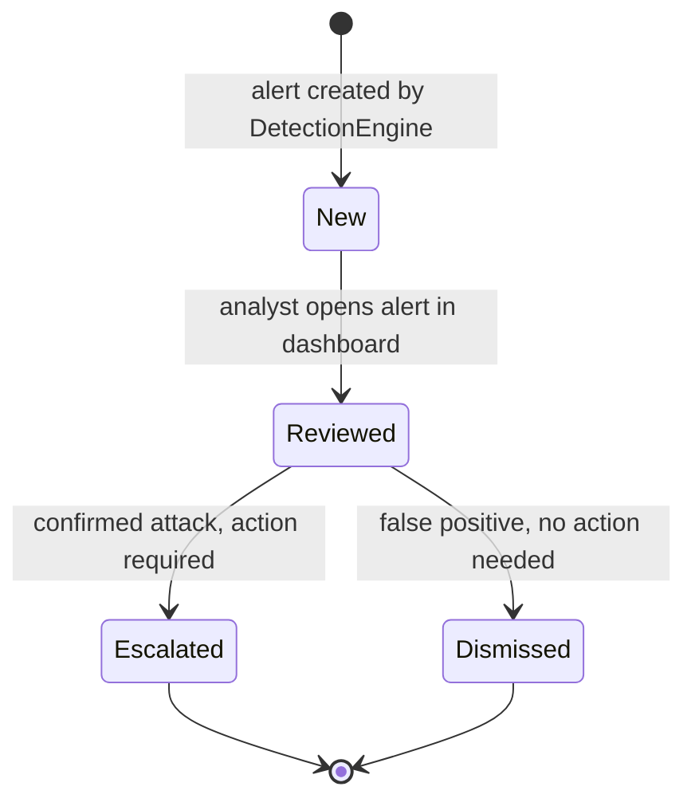

# Design Diagrams

UML design for the Network-Security-Analyzer. All diagrams render natively on GitHub.

---

## Use Case Diagram

Two actors interact with the system: the **Security Analyst** (human operator who monitors alerts, manages rules, and reviews logs) and the **Network Interface** (system actor representing the automated flow of live traffic).

---

## Class Diagram

`DetectionEngine` is central: it depends on `SignatureLoader` for rules and `MetricAggregator` for rolling statistics. On a match it delegates to `AlertGenerator`, which writes through `Logger` and produces `Alert` objects. `MonitoringSession` is the lifecycle controller that owns a `PacketCapture` instance.

---

## Component Diagram

Components and the interfaces through which they communicate.

---

## Deployment Diagram

All components run on a single host machine connected to the local network via a NIC. The host runs three concurrent processes; a browser accesses the dashboard over HTTP. The monitored server is a separate node on the same network whose traffic is observed.

---

## Activity Diagram

End-to-end operational flow from startup to shutdown.

---

## Sequence Diagram

Interactions during a single packet capture and detection cycle that results in an alert.

---

## State Transition Diagrams

### System Lifecycle

### Alert Lifecycle

